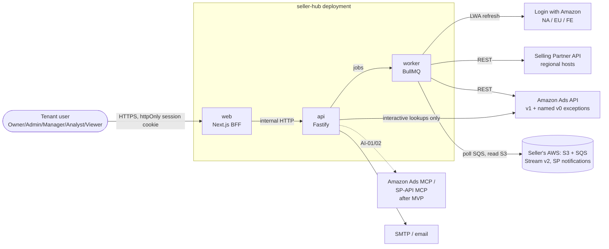
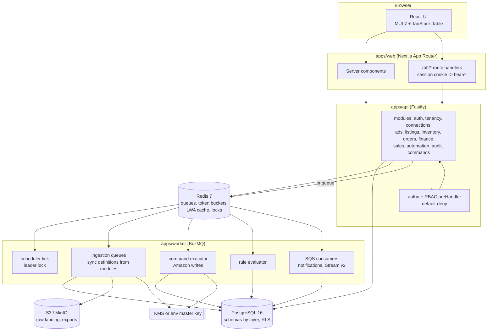
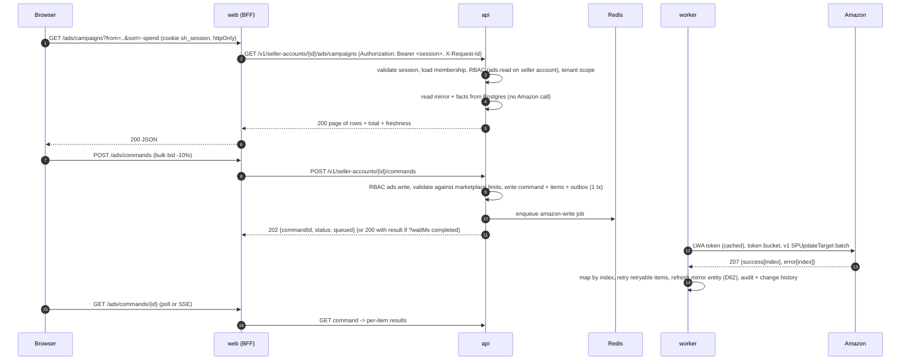
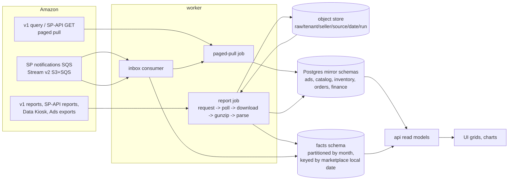

# Architecture overview

Task P2-ARCH, 2026-11-10. Binding inputs: `docs/DECISIONS.md` (D0–D63), `docs/SCOPE.md` (23 MVP rows),
`docs/discovery/*`, `catalog/**`. Each structural choice below is argued in an ADR under `docs/adr/`
(index: `docs/adr/README.md`); this page shows how the pieces fit. Status: awaiting Gate 2 (D20).

## 1. System context

- One deployment owns **one** SP-API app and **one** Ads API LWA client (D1 c: self-host first; each
  self-hoster registers a private app). The schema is multi-tenant from day one; SaaS (D1 b) opens after
  P6-SEC with the same code.
- Seller-hub calls Amazon **directly** with each seller account's own LWA refresh token (D52).
- Amazon is reached only from server processes. The browser talks to the web BFF only (ADR-0003).

## 2. Containers

| Container | Runs | Owns | ADR |
|---|---|---|---|
| `apps/web` | Next.js App Router, Node runtime | pages, BFF route handlers, session cookie, no business logic, no DB access | 0003 |
| `apps/api` | Fastify 5 on Node 24 LTS | HTTP API (contract-first), authn/RBAC, commands intake, interactive Amazon lookups | 0002, 0004, 0010 |
| `apps/worker` | BullMQ workers + scheduler (same image, role by env) | ingestion, Amazon writes, rule runs, SQS consumers, maintenance (partitions, purge) | 0008, 0011 |
| `modules/*` | workspace packages, imported by api and worker | one feature module each: service, repository, sync definitions, command handlers, routes | 0001, 0002 |
| `packages/amazon-*` | library | LWA, rate limiting, retries, 207 mapping, generated SP-API / Ads clients | 0006 |
| PostgreSQL 16 | — | system of record (mirror, facts, ops, identity) | 0009 |
| Redis 7 (`noeviction`, AOF) | — | BullMQ, token buckets, LWA access-token cache, locks, short read cache | 0006, 0008 |
| S3 / MinIO | — | raw report payloads (retention), export files | 0009 |
| `apps/mcp` (later, AI-04) | — | seller-hub MCP server over our own API | 0007 |

## 3. Request path (browser → BFF → API → Amazon)

Rules on this path:

1. **Reads come from the database.** User requests never call low-rate Amazon operations (SCOPE §5 risk 5).
   The only Amazon calls made inside a user request are *interactive lookups* the UI needs while the user
   types (keyword / bid / product recommendations and category tree for ADS-06/08: `EX-TARGETING-RECS`,
   `EX-TARGETING-DISCOVERY` in `docs/discovery/ads-domains.md` §4). They go through the same client,
   limiter and audit-free read cache, and fail fast with 503 + `Retry-After` instead of queuing.
2. **Every write to Amazon is a command** executed by the worker (ADR-0011). The API returns 202; the
   caller may pass `waitMs` (≤ 10 000) to receive the finished result in the same response.
3. **Freshness (D62 a):** one mode — DB mirror. After each write the executor re-reads the touched entities;
   a per-campaign "Refresh" button enqueues a high-priority entity sync; Stream v2 adds hourly metrics in v1
   (PLT-12, D58).
4. Tokens: the browser holds only an opaque, httpOnly session cookie. Amazon tokens never leave the worker /
   api processes; identity sessions are validated server-side (ADR-0004).

## 4. Data path (Amazon → worker → raw → normalised → facts → API → UI)

- **Raw landing**: every downloaded report / export / Parquet object is written to object storage before it is
  parsed (re-parse without re-requesting; Amazon report retrieval rates are ~1/min — `catalog/spapi/operations.json`
  `reports.createReport` / `getReportDocument` rate 0.0167). Paged JSON pulls are not landed (the response is
  small and re-pullable) unless a sync definition opts in.
- **Normalised mirror**: one table per Amazon entity, Amazon ids kept as text, upsert by natural key, `synced_at`
  and `amazon_last_updated` columns (P2-DATA designs the tables).
- **Facts**: daily (and later hourly) metric rows, upsert by (seller account, entity, local date, …); a re-run of
  the same window replaces the rows (Amazon restates: Ads conversions are by traffic date and are revised; Stream v2
  restatement window 70 days — `catalog/ads/stream.json`).
- **Read models**: the API joins mirror + facts per request; heavy aggregates get materialised summary tables
  refreshed by the ingestion run that changed them (no ad-hoc cross-tenant views).

## 5. Module map and where each MVP feature lives

Workspace modules (`modules/<name>`, ADR-0001/0002). Each module owns its routes, service, repository, sync
definitions, command handlers, contract file and migrations; the web app owns one route group per module.

| Module | Responsibility |
|---|---|
| `platform-auth` | users, sessions, password / TOTP, invitations (ADR-0004) |
| `platform-tenancy` | tenants, memberships, role grants, seller accounts, marketplaces, reference limits |
| `platform-connections` | LWA connect flows (Ads, SP-API), credential vault, profile discovery, connection health |
| `platform-audit` | audit log, change history, History screen |
| `platform-commands` | command intake, command executor framework, 207 mapping (uses `packages/amazon-core`) |
| `ads` | SP structure mirror, reports → facts, Campaign Manager read models, SP entity commands, portfolios |
| `automation` | rule definitions, evaluator, proposals, caps, kill switch |
| `listings` | listings / catalog mirror and screen |
| `inventory` | FBA inventory mirror |
| `orders` | orders (no PII), order metrics |
| `finance` | financial transactions |

| Row | Feature | Module(s) | api | worker | web route group | Amazon source (catalogue) |
|---|---|---|---|---|---|---|
| PLT-01 | tenant, users, BFF login, 5 roles, invitations | platform-auth, platform-tenancy | auth + tenancy routes | email job | `(auth)`, `settings/members` | — |
| PLT-03 | connect Ads account, list/choose profiles | platform-connections | connect start/callback, profile list | profile discovery sync | `settings/connections` | v0 `listProfiles` (EX-PROFILES), v1 `QueryAdvertiserAccount` — `catalog/ads/operations.json` |
| PLT-04 | switch seller account / marketplace; tz, currency, limits as data | platform-tenancy | context + ref endpoints | limits seed job | shell switcher | profile `countryCode/currencyCode/timezone`; `refs/amazon-ads/docs/reference/concepts/limits.md` |
| PLT-05 | sync engine | `packages/ingestion` + every module's sync definitions | sync status endpoints | scheduler, queues, buckets | `settings/sync` health | `catalog/spapi/operations.json` `rateLimit`; `refs/amazon-ads/docs/reference/concepts/rate-limiting.md` |
| ADS-01 | SP structure sync | ads | — | `ads.sp-structure` (v1 query, paged) + `ads.sp-export` (daily) | — | v1 `SPQueryCampaign/AdGroup/Ad/Target`; EX-EXPORTS — `catalog/ads/operations.json` |
| ADS-02 | daily performance reports | ads | — | `ads.sp-report-daily` report job | — | v1 `AdsApiv1CreateReport/RetrieveReport`, fields `catalog/ads/reports.json` (D57: v1 only) |
| ADS-03 | Campaign Manager (read, L0) | ads | grid + KPI + chart read models | — | `ads/campaigns` tabs | DB |
| PLT-07 | safe write layer | platform-commands | command endpoints | `amazon-write` queue | command result drawer | v1 207 ops (`multiStatus207` in `catalog/ads/operations.json`) |
| AUT-01 | rule engine + 1 bid rule | automation | rule CRUD, proposals, approve | `automation.evaluate` | `automation/rules` | reads facts; writes v1 `SPUpdateTarget` via commands |
| PLT-06 | audit + History | platform-audit | history endpoints | `ads.change-history` sync | `history` | EX-CHANGE-HISTORY `getHistory` |
| PLT-02 | connect SP-API | platform-connections | connect start/callback | participations sync (daily) | `settings/connections` | `sellers.getMarketplaceParticipations` (0.016 rps) — `catalog/spapi/operations.json` |
| CAT-01 | listings sync | listings | — | `listings.merchant-report` + `listings.items-issues` | — | report `GET_MERCHANT_LISTINGS_ALL_DATA` (`catalog/spapi/reports.json`), `listingsItems.searchListingsItems`, `catalogItems.getCatalogItem` |
| CAT-02 | Listing screen | listings (+ inventory, ads joins) | listing read model | — | `listings` | DB |
| ADS-04 | bulk actions with per-row results | ads, platform-commands | bulk command endpoints | executor | Campaign Manager bulk bar | v1 `SPUpdate*`; bid recs EX-TARGETING-RECS |
| ADS-05 | SP campaign detail | ads | detail read + commands | executor | `ads/campaigns/[id]` | v1 `SPUpdateCampaign` |
| ADS-06 | SP ad group detail | ads | detail read + commands + lookups | executor | `ads/ad-groups/[id]` | v1 `SPCreate/UpdateAd/Target`; EX-TARGETING-RECS |
| ADS-07 | search terms | ads | search-term read model + commands | `ads.sp-report-search-term` | ad group tab | v1 report search-term fields (coverage per D57: hide missing columns) |
| ADS-08 | create SP campaign | ads | create-tree command, lookups | executor (tree command) | `ads/campaigns/new` | v1 `SPCreate*`; EX-TARGETING-RECS, EX-TARGETING-DISCOVERY |
| ADS-09 | portfolios | ads | portfolio read + commands | `ads.portfolios` sync, executor | `ads/portfolios` | EX-PORTFOLIOS (v0 adapter) |
| INV-01 | FBA inventory | inventory | joins for listing/ads | `inventory.fba-summaries` | columns in listings/ads | `fbaInventory.getInventorySummaries` (2 rps) |
| ORD-01 | sales overview + TACoS | orders (sales read model), ads facts | sales read model | `orders.order-metrics` | `sales` | `sales.getOrderMetrics` (0.5 rps) |
| ORD-02 | orders, no PII | orders | list + detail | `orders.report-backfill`, `orders.search-incremental` | `orders` | report `GET_FLAT_FILE_ALL_ORDERS_DATA_BY_LAST_UPDATE_GENERAL`; `orders@2026-01-01.searchOrders` (0.0056 rps); client refuses restricted ops (D11) |
| FIN-01 | financial transactions | finance | list + per-SKU/month aggregates | `finance.transactions` | `finance` | `finances@2024-06-19.listTransactions` (0.5 rps), `listFinancialEventGroups` |

Where the design depends on the second console pass (D59): validation messages, tooltips and field rules for
ADS-05/06/08 (SP detail and builder) come today from `catalog/legacy/web-ux-rules.json` (UX-14..UX-16), the
v1 product-specific contracts and `concepts/limits.md`. They are **data** (marketplace limits table, copy files,
contract schemas), so a later console pass changes data and copy, not structure.

## 6. Seams kept for later (not built in MVP)

| Later item | Seam in MVP | ADR |
|---|---|---|
| Vendor (D5, D60 v1) | `seller_account.account_type` = `seller` \| `vendor`; Ads ad identifiers `sku` \| `asin` in the mirror; SP-API vendor ops are just other generated clients; sync definitions filter on account type | 0004, 0006, 0008 |
| PII (D11 later) | `pii` schema reserved; client refuses `restricted` ops (`catalog/spapi/operations.json` `restricted`); RDT method stubbed | 0006, 0009 |
| SP-API notifications (PLT-11), Stream v2 (PLT-12, D58) | inbox table + SQS consumer job type exist in the ingestion engine; destinations configured per seller account | 0008 |
| AI assistant (AI-01/02, D50 a) | `assistant` command source; approval step already required by the command model; MCP client package slot | 0007, 0011 |
| seller-hub MCP server (AI-04, D50 b) | delegated machine tokens in auth; every capability already behind the REST contract | 0004, 0007, 0010 |
| SaaS (D1 b) | tenancy + RLS, KMS key provider, per-tenant fair scheduling in the limiter | 0004, 0005, 0006, 0014 |
| Other regions (D4) | region on seller account; regional hosts table from `docs/discovery/ads-domains.md` §1 and SP-API endpoints | 0006 |
