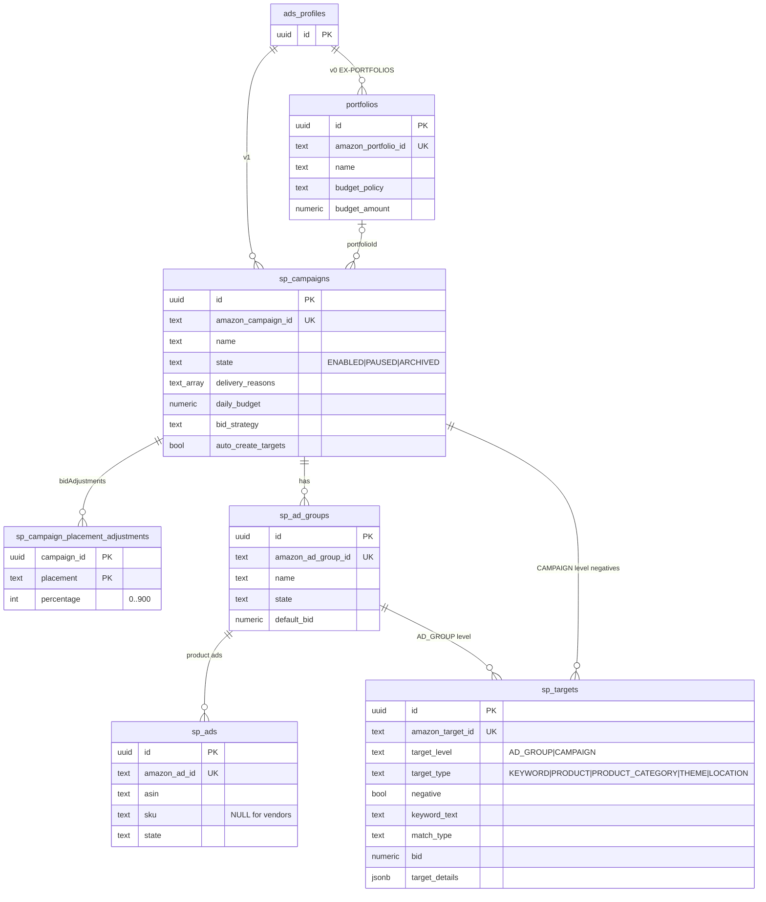

# ERD — `ads` (Sponsored Products mirror)

DDL: `db/design/05_ads.sql`. All rows carry `tenant_id`, `seller_account_id`; parents are referenced by our
UUID **and** the Amazon id is kept for joins with facts. Metrics are in [erd-facts.md](erd-facts.md).

