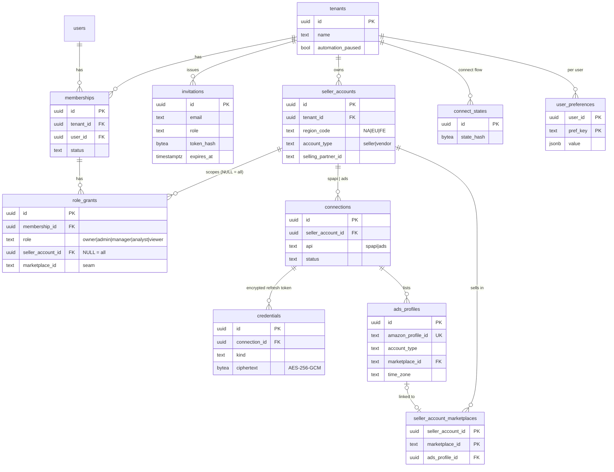

# ERD — `core` (with `identity` links)

DDL: `db/design/03_core.sql`. Key columns only; every table except `tenants` carries `tenant_id`
(composite FKs `(tenant_id, x_id)`). `identity.*` is drawn in [erd-identity.md](erd-identity.md).

