# ERD — `facts` (monthly partitions on local `date`)

DDL: `db/design/06_facts_ads.sql`, `db/design/12_facts_ops.sql`. No FKs (partitioned; purge by seller account).
Dotted lines are logical joins on `(seller_account_id, amazon_*_id)` or `(seller_account_id, marketplace_id, sku/asin)`.
Every PK starts with `(tenant_id, seller_account_id, date, …)`.

```mermaid
erDiagram
  sp_campaigns |o..o{ ads_sp_campaign_daily : "amazon_campaign_id"
  sp_campaigns |o..o{ ads_sp_placement_daily : "amazon_campaign_id"
  sp_ad_groups |o..o{ ads_sp_ad_group_daily : "amazon_ad_group_id"
  sp_targets |o..o{ ads_sp_target_daily : "amazon_target_id"
  sp_targets |o..o{ ads_sp_search_term_daily : "amazon_target_id"
  sp_ads |o..o{ ads_sp_ad_daily : "amazon_ad_id"
  listings |o..o{ sales_daily : "asin / sku scope"
  fba_inventory |o..o{ inventory_fba_daily : "sku x fnsku"
  transaction_lines |o..o{ finance_sku_daily : "aggregated"

  ads_sp_campaign_daily {
    date date PK
    text amazon_campaign_id PK
    bigint impressions
    bigint clicks
    numeric cost
    numeric sales
    bigint purchases
    numeric top_of_search_impression_share
  }
  ads_sp_ad_group_daily {
    date date PK
    text amazon_ad_group_id PK
  }
  ads_sp_target_daily {
    date date PK
    text amazon_target_id PK
    text targeting
    text match_type
  }
  ads_sp_ad_daily {
    date date PK
    text amazon_ad_id PK
    text asin
    text sku
  }
  ads_sp_search_term_daily {
    date date PK
    text amazon_ad_group_id PK
    text amazon_target_id PK
    text search_term PK
  }
  ads_sp_placement_daily {
    date date PK
    text amazon_campaign_id PK
    text placement PK
  }
  sales_daily {
    date date PK
    text marketplace_id PK
    text scope_kind PK "marketplace|asin|sku"
    text scope_value PK
    numeric total_sales
    int unit_count
  }
  inventory_fba_daily {
    date date PK
    text seller_sku PK
    text fn_sku PK
    int fulfillable_quantity
  }
  finance_sku_daily {
    date date PK
    text seller_sku PK
    text breakdown_type PK
    numeric amount
  }
  sp_campaigns {
    uuid id PK
  }
  sp_ad_groups {
    uuid id PK
  }
  sp_targets {
    uuid id PK
  }
  sp_ads {
    uuid id PK
  }
  listings {
    uuid id PK
  }
  fba_inventory {
    uuid id PK
  }
  transaction_lines {
    uuid id PK
  }
```

All Ads facts share the measures impressions, clicks, cost, sales, purchases, units_sold (v1 `metric.*`) and
`currency`; ratios are computed from sums (conventions §5).
