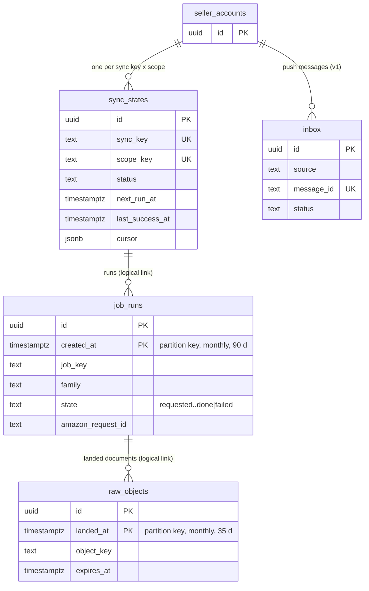

# ERD — `ingest`

DDL: `db/design/04_ingest.sql`. All rows carry `tenant_id`, `seller_account_id`.

`job_runs` and `raw_objects` are partitioned; links to them are logical (no FK) so partitions can be dropped
independently.
